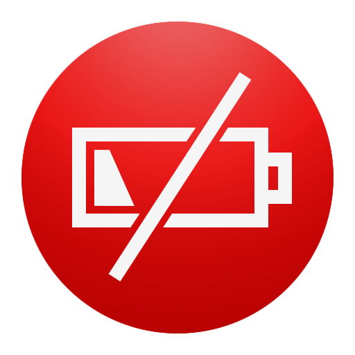

 # Informatie over BatteryAlert 
 In deze handleiding is beschreven welke stappen uitgevoerd moeten worden voor het genereren van een nieuwe broker versie

# Actiepunten
## Voorbereidingen package maken

In de repo zijn lege directories niet opgenomen. Deze directories zijn wel nodig als je een package opnieuw wil aanmaken.
Voer de volgende commando's uit om de directories terug te krijgen.
1. Start een terminal op (of iTerm)
2. Ga naar de directory waar deze readme staat beschreven (hoofddirectory van de repo)
3. Voer de volgende commando's uit (als gewone gebruiker):
```bash
cd munkipkg_project/batteryAlert
mkdir -p build payload scripts
cd -
```

## Pacakge wijzigingen
Voer de wijzigingen door en pas het versienummer in de "build-info.plist" aan en voer het volgende commando uit:
bin/create_package.zsh


## Aanpassingen opslaan in git
Zodra je aanpassingen hebt gedan in deze repo voer dan de volgende commando's uit om de wijzigingen op te nemen in bitbucket:
ga naar de hoofddirectory van de repo (war de readme.md staat)
```bash
git add .
git commit -m "<beschrijf de wijzigingen>"
git push
```

# Informatie

<table border="1" style="width:100%">
  <tr>
    <th style="color:red"><b>Onderwerp</b></th>
    <th style="color:red"><b>Waarde</b></th> 
  </tr>
  <tr>
    <td>Application</td>
    <td>BatteryAlert</td> 
  </tr>
  <tr>
    <td>Version</td>
    <td>24.04.25</td> 
  </tr>
  <tr>
    <td>Bundle Identifier</td>
    <td>nl.belastingdienst.batteryAlert</td> 
  </tr>
  <tr>
    <td>Code sign</td>
    <td></td> 
  </tr>
  <tr>
    <td>Scripts in package</td>
    <td></td> 
  </tr>
</table>


# Locatie data

<table border="1" style="width:100%">
  <tr>
    <th style="color:red"><b>Onderwerp</b></th>
    <th style="color:red"><b>Waarde</b></th> 
  </tr>
  <tr>
    <td>Application File</td>
    <td>~/OneDrive/DBO_macOS_Packaging/batteryAlert/24.04.25/batteryAlert-24.04.25.pkg</td> 
  </tr>
  <tr>
    <td>Metadata File</td>
    <td>~/OneDrive/DBO_macOS_Packaging/batteryAlert/24.04.25/batteryAlert-24.04.25.plist</td> 
  </tr>
<table>

## Icon
{width=100px}


## Details
Description
```bash
BatteryAlert geeft je een geluidsmelding en een popup als je nog minder dan 30 minuten accutijd over hebt voordat je MacBook uitvalt
```

## Scripts
### Preinstall
Preinstall_script
```bash
```

### Postinstall
Indien de app standaard in de Dock moet komen neem dan het volgende script op in de postinastall.

Postinstall_script
```bash
#!/bin/zsh
 
# Date: 2024-04-18
# Author: Edwin Pijper

#----------------------------------------------------------
# Variables
#----------------------------------------------------------
APP=nl.belastingdienst.batteryAlert.plist

#----------------------------------------------------------
# Main
#----------------------------------------------------------
echo "#--------------------------------------------------------------------------"
echo "# Postinstall script : Start installing app \"${APP}\""
echo "#--------------------------------------------------------------------------"

echo "Load Launchagent ${APP}"
launchctl load /Library/LaunchAgents/${APP}

echo "#--------------------------------------------------------------------------"
echo "# Postinstall script : for app \"${APP}\" Finished"
echo "#--------------------------------------------------------------------------"
```

### PreUninstall
PreUninstall_script
```bash
#!/bin/zsh
 
# Date: 2024-04-18
# Author: Edwin Pijper

#----------------------------------------------------------
# Variables
#----------------------------------------------------------
APP=nl.belastingdienst.batteryAlert.plist

#----------------------------------------------------------
# Main
#----------------------------------------------------------
echo "#--------------------------------------------------------------------------"
echo "# Postinstall script : Start installing app \"${APP}\""
echo "#--------------------------------------------------------------------------"

echo "Unload Launchagent ${APP}"
launchctl unload /Library/LaunchAgents/${APP}

echo "#--------------------------------------------------------------------------"
echo "# Postinstall script : for app \"${APP}\" Finished"
echo "#--------------------------------------------------------------------------"
```

### PostUninstall
PostUninstall_script
```bash
```

# Loglocations
Locatie waar de installatie log staat.

- /var/log/install.log
- /Library/Application Support/AirWatch/Data/Munki/Managed Installs/Logs/ManagedSoftwareUpdate.log

## Munki cache
/Library/Application Support/AirWatch/Data/Munki/Managed Installs/Cache

